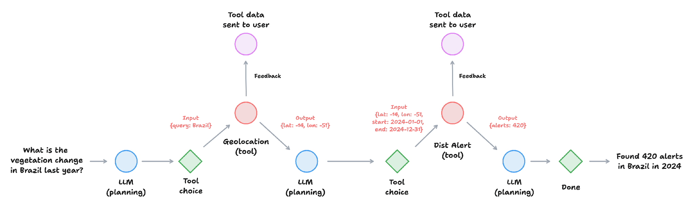
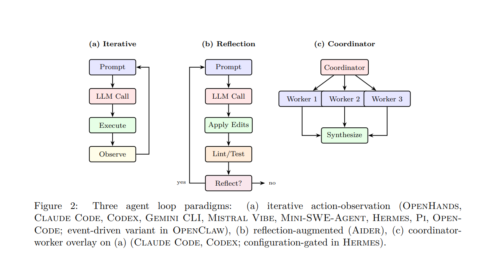
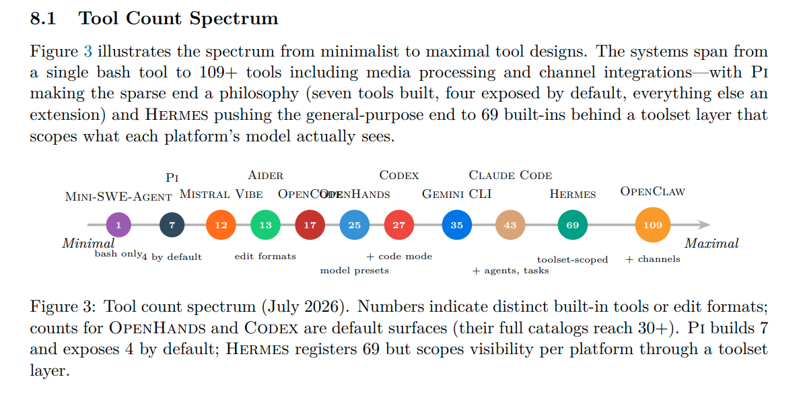
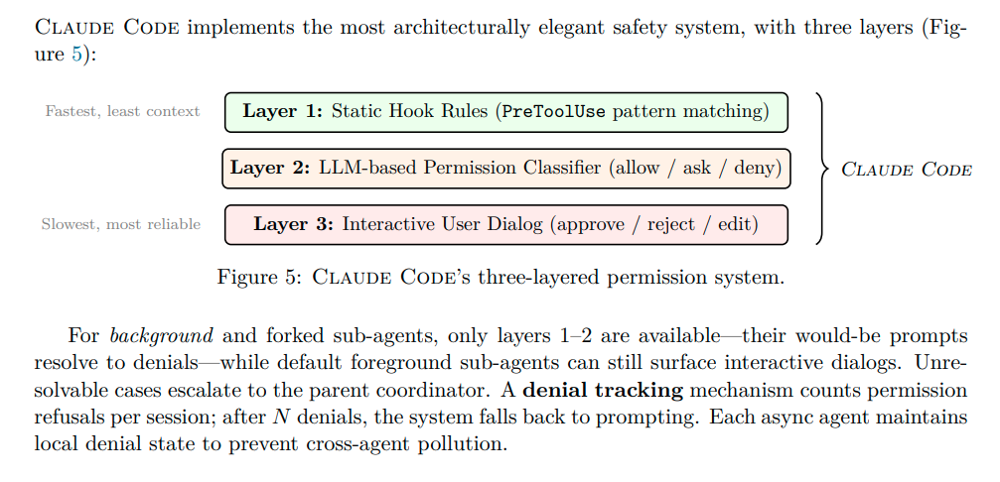
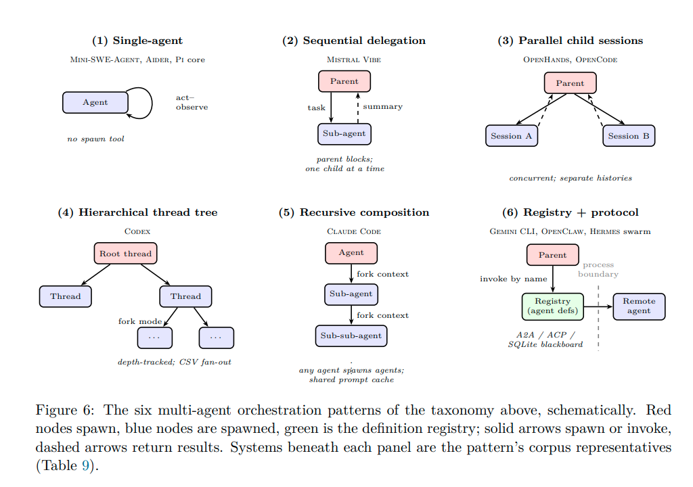

# cupids-harness

https://cupid.dev/
```
I believe that there are properties or characteristics of software that make it a joy to work with. The more your code has these qualities, the more joyful it is to work with; but everything is a tradeoff so you should always consider your context.
There are likely many of these properties, overlapping and interrelating, and there are many ways to describe them. I have chosen five that underpin much of what I care about in code. There is a diminishing return; five are enough to make a handy acronym, and few enough to remember.
```
https://dannorth.net/blog/cupid-for-joyful-coding
```
What started as lighthearted iconoclasm, poking at the bear of SOLID, has developed into something more concrete and tangible. If I do not think the SOLID principles are useful these days, then what would I replace them with? Can any set of principles hold for all software? What do we even mean by principles?

I believe that there are properties or characteristics of software that make it a joy to work with. The more your code has these qualities, the more joyful it is to work with; but everything is a trade-off so you should always consider your context.

There are likely many of these properties, overlapping and interrelating, and there are many ways to describe them. I have chosen five that underpin much of what I care about in code. There is a diminishing return; five are enough to make a handy acronym, and few enough to remember.

I will expand on each property in future articles so that this one does not get any longer, so please forgive me for not being more comprehensive.
```


## laws of programming

- Conway's Law
  - “Any piece of software reflects the organizational communication structure that produced it.”

- Mooer's Law
  - "An information retrieval system will tend not to be used whenever it is more painful and troublesome for a customer to have information than for him not to have it.""
    - make the topic easy to find
    - make the information more visual
    - keep it short
    
    
- Wirth's Law
  - "The hope is that the progress in hardware will cure all software ills. However, a critical observer may
    observe that software manages to outgrow hardware in size and sluggishness."
  
- Goodhart's Law
  - "When a measure becomes a target, it ceases to be a good measure"
  
- Hyrum's Law
  - "With a sufficient number of users of an API, it does not matter what you promise in the contract:
    all observable behaviors of your system will be depended on by somebody."

_James Martin's method of rapid development: In general, RAD approaches to software development put less emphasis on planning and more emphasis on an adaptive process. Prototypes are often used in addition to or sometimes even instead of design specifications_

## cupids for joyful coding and harnessing agents for the rest

I think that the intermingling of agent harnesses for rapid planning & application development is rapidly being built into different directions; one being fully automated, orchestrated coding agents; another leaning towards vibe-coding with human-feedback (or it's own loop); or simply a useful pair programmer that is aware of the context and functionalities made available to them. I believe that there is joy to be had to work with AI agents learning your intentions and transducing sequences of words [tokenized] into a problem & solution domains that meets a need [in the minimal cognitive distance between what you write, what the language model transduces, what decisions agent(s) make, and the task-completion]. Ideally, not only should it be enjoyable to use but also I want to love using it and avoid abusing it [in a measurable and realistic manner].


The five CUPID properties are:

- Composable: plays well with others
- Unix philosophy: does one thing well
- Predictable: does what you expect
- Idiomatic: feels natural
- Domain-based: the solution domain models the problem domain in language and structure

The sixth property is:

- **self-similar**: looks the same at every scale
    - **self-improving**
        - 
    - **self-taught**
        - 
    - **self-modifyiong**
        - 
    - **self-evolving**
        - 
    - **self-improving**
        - 
     - **self-replicating**
        - 
     - **self-aware**
        - 
  - **affinity** (from the Latin, affinis, "connected with") 
    - 
  - **identity** (from the Latin, identitas, "sameness")
    - 


  - **measure** (from the Latin, mēnsūra, "a measure")
    - 

  - generally address only scores on a single task for only an agent or for an agent and human expenditure and capability
    - applications to collections of tasks (**benchmark scores**) can be **domain-based** and varying in complexity
      - that is where at any magnification there is a smaller learning task that is similar to the whole collection of tasks learned.      
    - **task-completion time horizon** is the task duration (measured by human expert completion time) at which an agent is predicted to succeed with a given level of reliability
 

## useful defintions

**Agent**: 

    1. an LLM agent runs tools in a loop to achieve a goal
    2. an agent is a decision-making layer that takes a goal, develops a plan, invokes tools, and adapts based on results 
    3. a model plus a harness

**Skills**:

    1. reusable, domain-specific capabilities the agent can invoke (think of them as functions it has been taught)
    
**Tools**:

    1. external software APIs, databases, or services that the agent can call during execution to provide additional capabilities. 

**Commands**:

    1. discrete instructions that the agent issues to tools or sub-agents

**(Multi-Agent) Orchestration**:

    1. how you coordinate multiple agents, route tasks, and enforce policies across the workflow

**Guardrails**:

    1. the constraints, validators, and human-in-the-loop checkpoints that prevent the agent from producing or executing anything
       - that would violate your QMS, your risk framework, or patient safety requirements.

**Harness**: 

    1. the runtime that turns one into the other:
       - the model thinks, the harness decides what that thinking is allowed to touch.
    2. the complete infrastructure that wraps around an LLM to make it an functional agent
       - the model provides intelligence; the harness provides peripherals, memory, and boundaries
    3. the runtime that couples an LLM to the world through a loop, tools, context management, safety controls, orchestration, and extension surfaces.
    4. the layer that wraps language model and turns it into an agent able to act on a repository


## Harnesses

- Claude Code (Anthropic)
- Codex CLI (OpenAI)
- Gemini CLI (Google)
- Mistral Vibe (Mistral)
- OpenHands
- Aider
- Mini-SWE-Agent
- Hermes (Nous Research)
- Pi
- OpenCode
- OpenClaw

### Meta-Harness

- Omnigent

### Eval Harness

- [AgentBench: Evaluating LLMs as Agents](https://arxiv.org/abs/2308.03688)
- [Terminal-Bench](https://www.tbench.ai/news/announcement)

## Resources

- [Towards Long-Horizon Agents: A Survey](https://openreview.net/pdf?id=HyhfhlbWGh)
- https://www.anthropic.com/research/building-effective-agents
- https://github.com/RyanAlberts/best-of-Agent-Harnesses
- https://github.com/wannabeyourfriend/awesome-harness-evolution
- https://www.anthropic.com/research/building-effective-agents

- https://arxiv.org/abs/2005.14165
- https://arxiv.org/abs/2201.11903
- https://arxiv.org/pdf/2307.03172
- https://arxiv.org/abs/2205.11916
- https://arxiv.org/abs/2210.03629
- https://arxiv.org/pdf/2310.10501

    
### Frontier AI Model Evaluation Research

- [Research note: Metrics of Agent Ability](https://metr.org/notes/2026-07-24-metrics-of-model-ability/)
- [Task-Completion Time Horizons of Frontier AI Models](https://metr.org/time-horizons/)
- [Expenditure Horizon: Measuring Optimization Ability, with an Application to NanoGPT](https://metr.org/blog/2026-07-21-expenditure-horizon/)
- [Measuring AI Ability to Complete Long Software Tasks](https://metr.org/blog/2025-03-19-measuring-ai-ability-to-complete-long-tasks/)
- [Task Substitution and Uplift](https://metr.org/blog/2026-05-08-task-substitution-and-uplift/)
- [How Does Time Horizon Vary Across Domains?](https://metr.org/blog/2025-07-14-how-does-time-horizon-vary-across-domains/)
- [CoT May Be Highly Informative Despite “Unfaithfulness”](https://metr.org/blog/2025-08-08-cot-may-be-highly-informative-despite-unfaithfulness/)

### Agent Development Patterns

- [Agents with Constraints](https://developmentseed.org/blog/2026-10-16-agents-constraints/)
    - "Giving agents more freedom doesn't necessarily produce better results"
    - "Introduce constraints: limit the tools an agent can use, define how it returns information, or choose a smaller model for a specific task. These constraints can make agents more predictable and efficient"
    _Limit what agents can do_
    1. Give agents a specific set of tools rather than letting them generate or execute anything
        - smaller, more focused tools are usually easier to control and maintain.
        **small and composable**
    
    - Agents/LLM orchestrate
    - tools produce facts
    - top-level agent plays a coordinating role only
        - it will pick an appropriate (based on a user's query)
        - look at intermediate outputs
        - and call out to the next tool
    - the tools produce facts in a ****deterministic** manner
    - while agents act as a user-interface and glue between tools

    _Controlling how agents respond_
    2. We need to be careful about howm language models present information
        - when an agent retrieves the right data, asking the model to generate a response introduces another opportunity for errors
        E.g. Retrieval-Augmented Generation grounds responses in an existing knowledge embedding model
            - reduces mistakes but doesn't eliminate them
            - take it a step further and limit the format of the agent's response
        I.e. snow cover analysis agent that retrieves information APIs and fills in a pre-defined response templates
            - agent returns information in a **predictable** format

        E.g. Keep the original data separate from the generated text
            - agent identifies relevant data and use **well-defined** tools to retrieve or process it
            - results are delivered to the application without passing through for another round of text generation
        I.e. Building agents that return the underlying data itself
            - rendered maps, statistics, dataset links, etc.
            - so user can inspect primary sources alongside any natural language output

        - These agent development patterns are applicable to _bounded, well-defined use cases_ 
        - where the types of questions and analyses users will request are known in advance
        - It works best when the _workflow can be decomposed into a finite set of discrete tools_,
        - and when **predictability**, **reproducibility** and **cost efficiency** matter more than open-ended flexibility

    _Choosing smaller, focused models_
    3. Smaller models won't work for every application, but they might be a good solution when the _task is narrow enough_
        - there are tradeoffs, of course, rather than trying to build agents that plan for everything


#### [When Does Restricting a Coding Agent to execute_code Help? A Regime × Agent-Design Ablation](https://arxiv.org/abs/2607.10569)


#### [Small Language Models for Efficient Agentic Tool Calling: Outperforming Large Models with Targeted Fine-tuning](https://arxiv.org/abs/2512.15943)


### Agile Software Development & AI-Native Engineering


#### Coding Agents


- [SWE-agent: Agent-Computer Interfaces Enable Automated Software Engineering](https://arxiv.org/abs/2405.15793)


- [Inside the Scaffold: A Source-Code Taxonomy of Coding Agent Architectures](https://arxiv.org/pdf/2604.03515)

#### Uncle Bob

https://www.youtube.com/watch?v=zcLPGC-tvgk&t=464s
```
Got my first agent [early grok agent]...
Well maybe this thing can help me with this project...
I was cleaning up after it all the time...
It's interesting because it's fast, but its frustrating because it makes me slow...
Because it's fast it can do things I cannot...
These things are fast and they don't care how boring the work is...
Overall that is my goal, if these things are fast [and they are] and if I can constrain them to do a good job, then I'm not going impose my slowness upon them...

Agents may be fast and relatively smart, but they are as subject as humans are to messy code, maybe there is a difference in threshold but the threshold is still there. Code can get messy enough that the agents can't deal with it anymore...

**automated checks v.s. steering**
- Uncle bob's early prompts was describing TDD and CLEAN CODE driven for inserting automated checks instead of steering the agent
  "The agents and the models treat the rules and guidelines like Pirates of Caribbean sense"
- There is a phenomenon called "lost in the middle", as the context builds up in the model the stuff at the beginning and end has more prominence than the stuff in the middle
  "Eventually the tests will slow the down the agents to the point that they are much slower than humans... but as long as you can keep the margin of productivity higher than a human, you're still ahead of the game"
  "Now I'm in the midst of trying to get multiple agents talking to each other and handing off to each other, so one guy does one thing and the next one reviews it and the next one tests it, and the next one hardens it... the communication overhead is crazy, yet it's still faster by a large token than a human"

"Lets try the AGILE approach, let them do a story or two, maybe I'll get manually involved, and you know sort a few things out, then a few more stories... We may never skip the manual organizing step at the end... I don't know if it's possible"
- Building the wrong thing is something that you can still do...
- Spec-driven development
"the cost of change has plummeted to as close to zero as I think we're ever going to get [and well that's a prediction I'll probably lose but still] the cost of change has gone so far down that why would you do this upfront planning because that's expensive, just fiddle, fiddle, fiddle until it looks right."
```


- [Uncle Bob Martin on Clean Software, Craftsperson, Origins of SOLID, DDD, & Software Ethics](https://soundcloud.com/infoq-channel/uncle-bob-martin-software-craftsperson-solid-ddd-software-ethics)


#### Andinet's Tech blog

##### [Agentic AI Is Coming to the SaMD Lifecycle](https://blog.andinet.dev/agentic-ai-is-coming-to-the-samd-lifecycle)
  - Designing, building, and shipping **Software as a Medical Device (SaMD)** must comply with some of the most demanding regulatory frameworks in any industry
    - every step of SaMD demands rigorous documentation, traceabilty, and quality assurance
  - Agentic AI, a class of autnomous systems that answers questions, plans, executes, and verifies multi-step tasks across complex workflows
  _How we harness it responsibly at every phase of the SaMD development lifecycle_
  
        
  - "Traditional AI responds to single prompt with a single output"
  - "Agentic AI systems perceive, plan, act, and verify autonomously across multi-step workflows"
    - they maintain context, use tools, call APIs, coordinate with other agents, and loop back to correct their own work
  _The guardrails aren't an afterthought in this domain. They're the product_
  
  1. identification and user needs
  
     *agent pattern*:
        - research orchestrator agent
          - decomposes general clinical question into sub-tasks
          - dispatches to specialized tool-calling agents for task-completion
           
        
      *guardrails and evaluation*
        - agent constraints using guardrails [for source attribution and hallucination detection]
          - a validator runs post-generation
            - checking every cited source exists and the claim reasonably follows from source text
        - a scope constraint is required to prevent the agent from drifting
          - drifting into [clinical] domains outside the intended use you defined
          
   2. requirements gathering and software requirement specifications
   
      *agent pattern*
        - requirements engineering agent
          1. a need-to-requirement mapping skill
            - takes each user need statement and generates candidate technical requirements
              - following your SRS template format, [complete with requirement IDs, priority levels, and risk classification tags per ISO 14971].
          2. a traceability matrix skill
            - auto-populates a bidirectional traceability matrix linking each user need to it derived requirements
              - and forward-link placeholders for design inputs, code modules, and verification tests
        - the agent uses structured output, macine-parseable schemas [that can be imported directly into your requirements management tools, e.g. Jira, GitHub, etc.]
        
    3. architecture and software design
    
       *agent pattern*
       
       *guardrails and evaluation*
       
    4. construction and coding
    
        *agent pattern*
        
        *guardrails and evaluation*
        
    5. testing and verification
    
        *agent pattern*
        
        *guardrails and evaluation*
        
    6. validation and post-market surveillance
    
        *agent pattern*
    
        *guardrails and evaluation*
          
 

##### [The Old Rules Still Apply: Why Software Engineering Discipline Matters More in AI Engineering](https://blog.andinet.dev/the-old-rules-still-apply-why-software-engineering-discipline-matters-more-in-ai-engineering)
  - "Why write tests, specs, or design documents when a model can generate a working feature in minutes?"
    - "When implementation becomes cheap, the parts that were never about typing code become the whole job."
      - "Knowing what to build, and knowing whether what you built actually works, ..."
        - "... matter more now than they ever did"
     


### Agentic Systems, Agent Architecure, & Agent Harnessing

- [Prime Agent: Self-improving RLM Harness](https://arxiv.org/pdf/2608.23552)
- [Harness^2: Recursive Agent Harnessing for an Open World](https://arxiv.org/abs/2610.14224)
- [Why The Harness Matters More Than The Model | YC Paper Club](https://www.youtube.com/watch?v=n9xKblqyQ28)
- [The Best AI Models Fail at Physics: Coding Harnesses are to Blame](https://juliahub.com/blog/why-the-best-ai-models-fail-at-physics)
- [Why the Agent Harness Matters For Physical AI](https://juliahub.com/white-papers/why-the-agent-harness-matters-for-physical-ai)


#### [Harness Engineering: Anatomy, Architecture, and Evolution of Coding Agents](https://arxiv.org/pdf/2609.00006)
  - **Harness Engineering** is the design and evolution of that runtime that couples the LLM through a loop,  tools, context management, safety controls, orchestration, and extension surfaces

    
    _the harness has stopped being a tool and become a platform_
    
    
    $$Agent = Model + Harness$$
    
    - automate harness evolution
    - optimize harnesses against benchmarks
    - recast code itself as the harness substrate
    
    _the layer that wraps language model and turns it into an agent able to act on a repository_
    
    - "A harness is not a scaffold--quite"
      - **scaffold** names the structural code (the loop, the registries)
      - and **harness** names the shipped runtime artifact that embeds it
      
      e.g. *mini-swe-agent* scaffold is 100 lines of Python
           *Claude Code's* harness is a product with a terminal UI, a permission system, and a plugin ecosystem
           
    - "A harness is not an agentic framework"
      - a **framework** is a library the develop imports to build an agent
      - a **harness** is a runtime the developer works inside of
    
    - "A harness is not an evaluation harness"
      e.g. the *swe-bench* **harness** wraps an agent to run it against tasks;
          - an **agent harness** wraps a model to make it act
          - same word, opposite direction of wrapping
          
    - "A harness is not an orchestrator"
      - an **orchestrator** coordinates one or more harnesses from above and implements no editing loop of its own
        e.g. *omnigent* orchestrates eleven vendor harnesses and implements no editing loop of its own
            - its provides evaluating harnesses instead of evaluating a single harness
    
  - **minimal harness formalization**: how small each subsystem can shrink
  
    1. **agent loop**: alternates inference with action execution; owns stop conditions and failure recovery
       e.g. a linear `while` loop over one `bash` tool
    2. **language model integration**: speaks provider protocols; assembles the prompt ; manages caching; thinking, routing
       e.g. one `litellm` call, one `jinja` template
    3. **tools & actions**: defines and executes what the agent can do, file editing above all
       e.g. `bash` only
    4. **memory & context**:  rations the context window; persists knowledge across turns and sessions
       e.g. `unbounded linear history`
    5. **safety & permissions**: decides what runs, what asks, what is forbidden; isolates execution
       e.g. `cost and step limits`
    6. **orchestration**: spawns and coordinates sub-agents; connects to other agents
       e.g. `single-agent by design`
    7. **extensibility**: lets users and ecosystems add capability: config, hooks, skills, plugins, MCP
       e.g. structural typing (python protocols)

  - **maximal harness formalization**: shows where a decade of engineering headroom lies in each subsystem
  
    1. agent loop
       e.g. event-source conversion over a persistent event log, with parallel action batches
    2. language model integration
       e.g. shipped with 5 owned transports and 29 provider profiles; server-delivered model catalog
    3. tools & actions
       e.g. 43 typed tools with deferred loading; tool calls as V8-executed code
    4. memory & context
       e.g. agent-maintained cross-session memory pipeline; graph-based context distillation
    5. safety & permissions
       e.g. approval reviewer + three-platform OS sandbox
    6. orchestration
       e.g. recursive composition; cross-vendor coordination
    7. extensibility
       e.g. everything-is-an-extension runtime; marketplace-distributed plugins
  
  
  _two cross-cutting surfaces sit alongside the seven: the interface layer and the session substrate_
    1. *interface layer* through which humans and programs drive the harness
       - TUI, CLI flags, IDE Protocol, HTTP server, SDK
    2. *session substrate* that several subsystems share
       - transcripts, persistence, resume/fork
       
       
   - **LLM-powered code agents**
     - SWE-Agent
       - provide LLMs with file viewing and editing tools
     - CodeAct
       - unifying agent actions into executable code
     - ReAct
       - reasoning-action loop that underpins most current agent architectures
     - AutoCodeRover
       - replaces text-based search with AST-aware retrieval and spectrum-based fault localization
     - MASAI
       - decomposes the issue-resolution pipeline into modular sub-agents
         - and reports cost-aware results on SWE-Bench Lite
     - MAGIS & CodeR
       - formalize role-based multi-agent coordination for issue resolution
         e.g. Manager/Custodian/Developer/QA (MAGIS); explicit task graphs (CodeR)
     - Lingma SWE-GPT
       - trains a base model jointly with the SE process loop, an instance of the model-agent co-design
     - SWE-Search
       - layers Monte Carlo tree search over agent trajectories
         - see also Tree of Thoughts and LATS, with Plan-and-Solve as the simpler precursor
         - and Diversity-Empowers-Intelligence ensembles heterogeneous agents under a meta-policy
     - Agentless
       - reports that a fixed localize/repair/validate pipeline is competitive with agent loops
         - discussing whether agent complexity is necessary
     - OpenHands
       - automated harness engineering, which automatically evolve agent harnesses (tools, middleware, memory, sub-agent configuration) using observability-driven feedback
         - starting from 'bash-only' seed and the evolved harness transfers across model families
       - **component-level ablation** provides quantitative evidence for the architectural emphases we arrive at independently through source-code analysis: tools, middleware, and long-term memory carry the improvement, while the system prompt alone does not
       
   - **concurrent source-code taxonomies**
     - Inside the Scaffold
       - source-code taxonomy of 13 open source coding agent scaffolds
         - 12 dimensions in 3 layers
           - control architecture, tool/environment interface, resource management
       _most agents compose loop primitives rather than implementing a single one_
          - ReAct, generate-test-repair, plan-execute, retry, tree search
          
   - **multi-agent systems for swe**
     - MetaGPT
       - assigns specialized roles (product manager, architect, engineer) to different agents
     - ChatDev
       - organizes a role-playing development pipeline around chat-chain communication
     - AutoGen
       - provides a framework for multi-agent conversations
     - Magnetic-One
       - implements an orchestrator pattern with specialized sub-agents
     - MAGIS and CodeR
       - pair role decompositions with task graphs
     - Chain-of-Agents
       - sequences sub-agents over long inputs
       
   - **tool use in language models**
     - Toolformer
       - LLMs can learn to use external tools
     - Gorilla
       - LLMs can generate accurate API calls when provided with documentation
     - ToolLLM
       - sacled tool-use evaluation to 16000+ real-world APIs
     - AnyTool
       - hiearchical tool routing for large API surfaces
     - MCP
       - proposes a standard interface for connecting LLMs to external tools and data sources
       - emerged as a cross-system extensibility standard
   - **vendor-authored engineering guidance**
     - a complementary thread to the academic surveys is engineering guidance published directly by major LLM vendors
     
   - **2026 Harness Landscape**
       - "every vendor now ships a harness and the harness is no longer a greenfield"
         - Gemini is transitioning towards Antigravity CLI
         - Amazon folds into Kiro
         - X shipped Grok and acquired Cursor
         - That leaves Codex, Gemini CLI, Mistral Vibe open to the public
         - opencode and hermes grow
         - pi is minimal-core countertrend
         - Claw Code reimplimented claude code in python and rust
         - Many other forks in the same regard tieing open wieght model releases to their CLIs
         - aider entered de-facto community maintenance mode
       - "an orchestration layer that treats entire harnesses as interchangeable components behind a common API"
         - "adding cross-harness policies, a uniform OS sandbox, and shareable multi-device sessions"
         - databricks opensourced omnigent a meta-harness
         
  - **openclaw as an outlier**
    - its a personal AI assistant gateway but it delegates coding tasks to dedicated SWE agents through plugins
    
  - **omnigent as a meta-harness**
    - its an orchestration layer above harnesses
    - it wraps harnesses and custom agent configurations behind an API
      - adding cross-harnessing
      - uniform OS sandbox
      - shareable multi-device sessions

      
      
  1. Agent Loop Design
  
      _Design loops that prompt your agents_
  
     _Loop primitives (ReAct, generate-test-repair, plan-execute, multi-attempt retry)_
     
     _function as composable building blocks that agents layer in different combinations, not as mutually exclusive types_
  
     - *iterative action-observation*
     
     - *reflection-augmented*
     
     - *coordinator-worker*
     
     
     
    
 2. LLM integration and Model-Agent Co-design
 
     - *provider abstraction spectrum*
     
       1. single-provider tight coupling
       2. provider-first with generic fallback
       3. multi-provider via abstraction layer
       4. multi-provider via owned transports
       5. hybrid plugin-based
     
     - *prompt engineering architectures*
     
       1. capability gated snippets with hierarchical memory
       2. per-agent markdown prompts
       3. per-model prompts as server-delivered data
       4. prompt registry with cache tiers
       5. three-tier assembly with bit-perfect prefixes
       6. one small builder, co-varying with the toolset
       7. a model-family prompt matrix
       8. polymorphic prompts
       9. one-shot templates
       
     - *prompt content and rhetorical style*
     
       1. identity and persona
       2. verbosity control
       3. banned phrases and forbidden surface forms
       4. anti-gold-plating directives
       5. read-before-edit and verify-before-claim
       6. git commit policy: a convergence that dissolved
       7. emphasis markers
       8. tool-use philosophy
       9. what is conspicuously absent
       
     - *streaming and response processing*
     
       *Claude Code*: SSE with fine-grained events
           - supports extended thinking via thinking blocks with configurable budget_tokens
           
       *Codex*: WebSocket + SSE fallback
           - ResponseItem events parsed from JSON-RPC
           - Connection prewarm with generate=false
             - Turn state maintained via x-codex-turn-state header
         
       *Gemini CLI*: @google/genai SDK chat.sendMessageStream() with a four-attempt mid-stream retry
       
       *Mistral Vibe*: Mistral SDK stream_async() aggregates LLMChunk blocks
           - ThinkChunk blocks are routed into separate reasoning_content field
           - Aggregated usage stats are produced across the stream
           
       *Aider*: Token-level streaming with mdstream for rich terminal rendering.
           - Retry loop with exponential backoff; handles FinishReasonLength by resuming with assistant prefill
           
       *Mini-SWE-Agent*: Full response (no streaming), simplest approach; relies on model's native completion
       
       *OpenHands*: SSE via LiteLLM wrapper, now with first-class streaming plus an OpenAI Responses path
           - an LLM.stream field and token deltas forwarded through on_token callbacks
           - Support prompt caching markers for Anthropic models
           
       *Hermes*: five owned transport implementations: a ~23-value FailoverReason enum drives classified recovery
      
      *Pi*: nine wire-protocol implementations with a partial-json salvage parser for streamed tool arguments
          - paired with truncation guard, since salvaged arguments can validate while incomplete
          
      *OpenCode*: Vercel AI SDK streamText owns dispatch: token-granular part deltas are persisted 
          - and re-served over SSE by the embedded server,
          - so every client (TUI, web, IDE) replays the same stream
      
      *OpenClaw*: ACP delta events for text, thought, and tool calls
          - provider-specific transport streams handle the underlying SSE/WebSocket layer
          
          
     - *advanced API features*
       - *claude code*'s extended thinking integration exposes a budget_tokens parameter
         - that controls how much internal reasoning the model performs before responding
         - while LiteLLM does pass through Anthropic-specific conditional code in any multi-provider design
       - *codex*'s reasoning efforts enum spans minimal/low/medium/high/xhigh,
         - extended in mid-2026 with max and ultra--and ultra is not just more reasoning
         - the model catalog describes it as maximum reasoning with automatic sub-agent task delegation,
         - an effort level that chagnes orchestration behavior, unique in the corpus
       - *mistral vibe*'s per-model thinking field now spans five levels (off/low/medium/high/max)
         - mapped into Mistral reasoning_effort enum
         - and Pi normalizes the whole landscape behind a unified seven-level scale
           - translated through ten per-API thinkingFormat dialects
       - *codex*'s implements prompt caching via a prompt_cache key derived from the session's ThreadId
       - *aider*'s vision support warrants a note:
       
       
       
   3. Tool & Action Systems
   
     
     - *tool interface architecture* 
        - Mini-SWE-Agent sends everything through a single shell call 
        - (subprocess.Popen(shell=True)
            - wrapped only to kill the process group on timeout)—to rich typed contracts 
        - Claude Code’s 43 tools
        - each declare validation, permission checking, concurrency safety, and UI rendering
            - as separate interface concerns. 
            
     - *deferred tool loading*
     
     - *file-editing strategies*
       - "File editing is the core action for SWE agents."
       
     
     - *execution and sandboxing*
     
  4. Memory and Context Management
  
      - **threshold-triggered LLM compaction**: a de facto standard for production-grade context management,
        - though each newcomer hybridizes it with traits of the other strategies
          - (iterative summary merging, pluggable engines, session-tree substrates)
          
        e.g.
          Claude Code’s compaction triggers when the running token estimate enters a buffer
              - below the model’s effective context window 
              (AUTOCOMPACT_BUFFER_TOKENS = 13 000, with an env-overridable percent threshold for testing). 
              - The process: 
                1. strip images from messages (replace with [image] markers)
                2. group messages by API round, 
                3. invoke the LLM to generate a conversation summary,
                4. create a SystemCompactBoundaryMessage separating pre-compaction history from the summary.
              -  Post-compaction cleanup restores up to 5 files (POST_COMPACT_TOKEN_BUDGET = 50 000)
                 - and truncates skills to a per-skill 25 000-token budget

        - **persistent memory pipelines**
          - 
           
          e.g.
              - Claude Code persists per-project memory directories of Markdown facts; 
              - Pi and Mini-SWE-Agent deliberately persist nothing beyond the session substrate
              
      - **repository context**
        - Beyond conversation history, agents must manage code context
        
        
    5. Safety and Permission Models
    
    
     
          
    
    Mini-SWE-Agent implements only resource limits as safety mechanisms—step_limit,
cost_limit, and (added in the v2.4 line) a wall-clock limit and a consecutive-format-error cap,
plus an opt-in interactive confirm mode—sufficient for benchmark evaluation but inadequate for
production use.


    6. Multi-agent orchestration
    
    
    


    7. Extensibility Mechanisms

#### [What makes a harness a harness: necessary and sufficient conditions for an agent harness](https://arxiv.org/pdf/2606.10106)
#### [Better Harnesses, Smaller Models: Building 90% Cheaper Agents via Automated Harness Adaptation](https://arxiv.org/pdf/2607.08938)


### Auto Research

- [How we built our multi-agent research system (Claude)](https://www.anthropic.com/engineering/multi-agent-research-system)

### Data Science Agent

- [DS-STAR: A state-of-the-art versatile data science agent](https://research.google/blog/ds-star-a-state-of-the-art-versatile-data-science-agent/)
- [Skill-based Agentic Evaluation for Real-time Data Science Tasks](https://arxiv.org/pdf/2609.16487)
- [Harness Engineering Can Make Small Language Models Explore Like Large Language Models](https://openreview.net/forum?id=VHjhq6vui2)
  
#### Benchmarks

- UniDataBench
- DAComp
- DABstep
- KramaBench
- DA-Code
- DataSciBench


### Geospatial Data Science Agent

- [Axis Spatial's Geospatial Agent Benchmark Evaluations](https://www.axisspatial.com/arena/methodology#evaluations)
- GeoAnalystBench
- GeoBenchX
- GeoAgentBench
- GISAgentBench


        
